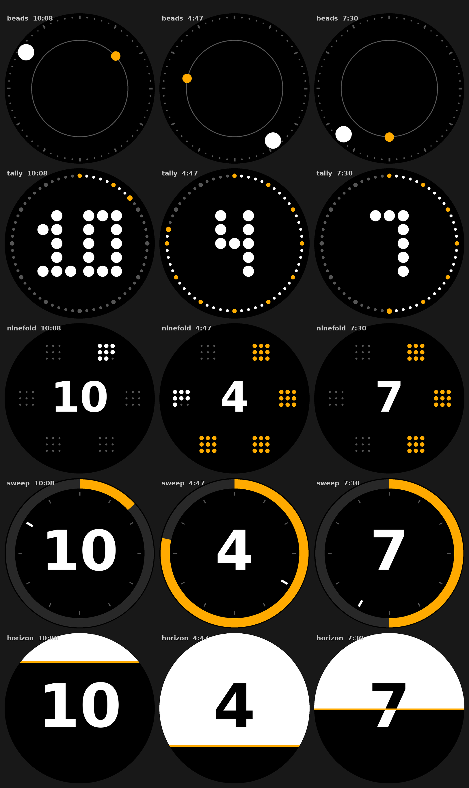
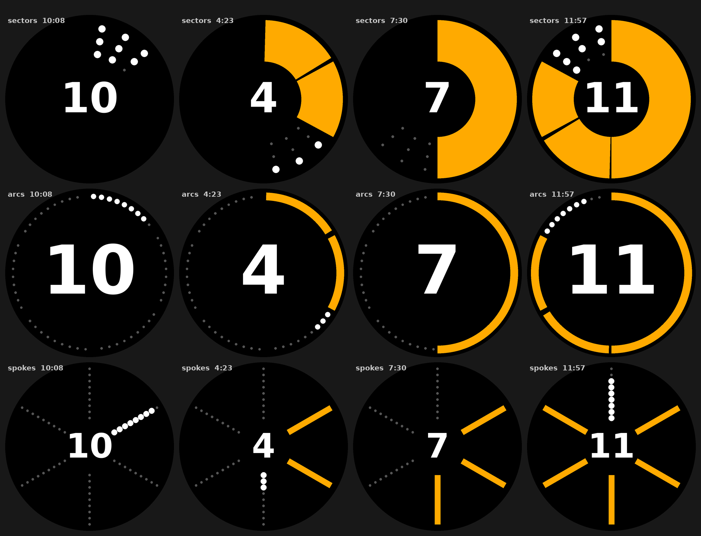

# Round Faces — TTMM-inspired watchfaces for Pebble Round 2

Six minimal watchfaces for the **Pebble Round 2** (SDK platform `gabbro`, 260×260,
64-colour e-paper) that also build for the original **Pebble Time Round** (`chalk`,
180×180). They borrow the spirit of the TTMM faces from the original Pebble:
time as a *count of things* (dots, ticks, blocks), lots of empty space, one accent
colour, and nothing on screen that is not telling you the time.



Round-native translations of the TIC-9TTMM / TIC-10TTMM counting rule
(`python3 design/render_mockups.py --round`). Sectors is built; Arcs and Spokes
are mockups only.



## The faces

| Face | How to read it |
|------|----------------|
| **Beads** | A clock with no hands. The big white bead on the outer track is the hour (it creeps forward like an hour hand). The small accent bead on the inner track is the minute. |
| **Tally** | Sixty dots around the rim light up one per minute, clockwise from 12. The fives are accent-coloured and the current minute is a slightly larger accent dot. The hour is a dot-matrix numeral. |
| **Ninefold** | A nod to TIC-9TTMM, bent into a wheel. Six 3×3 squares surround the hour numeral, one per ten minutes, starting top-right. Dots light up one per minute; when a square's tenth minute arrives the whole square turns accent. |
| **Sweep** | The outer band fills clockwise from 12 as the minutes pass. Twelve short ticks sit inside the band; the current hour's tick is long and white. Big hour numeral in the middle. |
| **Sectors** | TIC-9TTMM's rule, rebuilt for a circle. The ring is six 60° sectors, one per ten minutes, clockwise from 12. In the sector currently filling, nine dots light up one per minute in a 3×3 polar grid. The tenth minute fills the whole sector solid, and at :30 the first three solid sectors fuse into a half-disc. Future sectors stay empty. |
| **Horizon** | A horizon line sinks from near the top (:00) to near the bottom (:59). Above it the face is light, below it dark, and the hour numeral inverts where the line cuts through it. |

Every face shares the same two quiet status signals:

- **Phone disconnected:** a small hollow ring appears (centre on Beads, near the bottom elsewhere) and the watch buzzes once.
- **Battery ≤ 20 %:** the accent colour turns red.

There is deliberately no date, no seconds, no weather. Faces redraw once a minute
(`MINUTE_UNIT`), which is the battery-friendly choice on e-paper.

## Settings (Sectors)

Sectors has a settings page, built with the Rebble-maintained [Clay](https://github.com/pebble-dev/clay) fork (`@rebble/clay`, which knows the Round 2 platform; the original `pebble-clay` npm package does not).
Open the Pebble app on your phone, find Sectors under watchfaces, and tap the
gear. You can set:

- **Theme:** dark or light
- **Accent colour:** any of the watch's 64 colours
- **Low-battery red:** whether the accent turns red at 20 %
- **Hour numeral:** Bold (bundled DejaVu), Geometric (the system LECO font) or Dots
- **Seams:** thin gaps between finished sectors, or one growing pie
- **Fill order:** ring by ring (default) or clockwise column by column

Settings persist on the watch. Because it pulls in an npm package, run
`npm install` in `faces/sectors/` once before the first `pebble build`.
The other faces will get the same page once you've decided which ones to keep.

## Layout

```
pebble-faces/
├── design/
│   ├── render_mockups.py      # Pillow renderer used for the previews above
│   └── *.png                  # mockups at 10:08, 4:47, 7:30 for each face
├── _shared/
│   ├── common.h               # helpers shared by all faces (copied into each project)
│   └── wscript                # standard SDK build script (copied into each project)
└── faces/
    ├── beads/                 # one self-contained Pebble project per face
    ├── tally/
    ├── ninefold/              #   ninefold, sweep and horizon bundle a
    ├── sweep/                 #   digits-only subset of DejaVu Sans Bold
    ├── horizon/
    └── sectors/
```

Each project is a complete, standard Pebble SDK 4 project (`package.json`,
`wscript`, `src/c/main.c`, `src/c/common.h`), so you can build, install and
publish them independently. `_shared/` is the source of truth for the two
shared files; if you change one, copy it into every `faces/*/`.

All geometry is computed from the screen radius (see `sc()` in `common.h`),
and nothing uses floating point. The designs were drawn for 260 px and scale
down to 180 px for chalk.

## Building

Install the current Pebble tooling (Core Devices' fork). You need Python 3.10–3.13,
and on Linux a glibc 2.38+ distro (Ubuntu 24.04 or newer) for the emulator.

```sh
uv tool install pebble-tool --python 3.13
pebble sdk install latest
```

Then, inside any face directory:

```sh
cd faces/tally
pebble build
pebble install --emulator gabbro            # Pebble Round 2 emulator
pebble screenshot --no-open --emulator gabbro tally.png
```

To put it on your watch, pair your phone with the Pebble app and use

```sh
pebble install --phone <phone-ip>           # developer connection enabled in the app
```

or simply drag `build/tally.pbw` onto your phone and open it with the Pebble app.

Things to check on first build:

- If your SDK does not know the `gabbro` platform yet, remove it from
  `targetPlatforms` in `package.json` and preview on `chalk` (or update the SDK).
- The numeral vertical position on Sweep / Ninefold / Horizon is controlled by
  `NUMERAL_MID_OFFSET` at the top of each `main.c`. If the digits sit a little
  high or low on the real font, nudge that constant.
- Fill in `"author"` in each `package.json`.

## Design notes (the brainstorm)

Principles pulled from the TTMM family and applied to a round, colour e-paper screen:

1. **Count, don't read.** Minutes are shown as a tally of marks you glance at, not a
   number. Once you know the rule, the shape of the face *is* the time.
2. **The rim is the dial.** A round screen has a natural 60/12 division; put the
   minute information on the edge where a bezel would be and leave the middle empty
   or for a single large hour.
3. **One accent.** E-paper colours are muted, so everything is black/white plus one
   strong colour (chrome yellow by default). The accent carries meaning
   (the "now" mark, completed blocks, the horizon) rather than decoration.
4. **State is colour, not icons.** Low battery turns the accent red; a lost phone
   connection adds one hollow ring. No glyphs.
5. **Hour hands are optional.** Beads shows that a dot on a track reads as a hand once
   the eye learns it, and it leaves the face almost empty.

**Translating TIC-9 / TIC-10 to a circle.** Those faces count minutes as nine
dots that become a square on the tenth, and three squares that become a bar at
thirty. The rectangle is doing real work there, so the question was what plays
the role of "square" and "bar" on a round screen. Sectors answers: the square
becomes a 3×3 cell of a polar grid (three radii × three angles) inside a 60°
sector, the solid square becomes a solid wedge, and the bar becomes the half-disc
the first three wedges fuse into at :30. Arcs applies the same rule to the rim
only, and Spokes turns each ten minutes into a ray; both are in the renderer for
comparison.

Ideas not built yet, in rough order of how much I like them:

- **Quarters** — the minute ring drawn as four arcs of fifteen, with the current
  quarter made of dots and the completed quarters solid.
- **Grid** — a 6×10 dot grid (TIC-10TTMM style) wrapped into concentric arcs so it
  fits the circle.
- **Light variants** of all five (black marks on a white field), which may suit
  e-paper in daylight better. Swap `COLOR_BG`/`COLOR_FG` in `common.h` to try.
- **Clay settings page** for accent colour, light/dark, and whether the hour creeps
  on Beads — worth adding before publishing.

## Publishing later

- Pick names that are yours. "TTMM" is the designer's brand; these are
  *inspired by* those faces, not copies, and the README should say so in the
  store description too.
- The Rebble/Core store listing needs a 144×144 (or larger) icon, screenshots
  per platform (`pebble screenshot --all-platforms` builds them for you), and a
  banner. Take screenshots at a time where the design reads clearly (10:08 and
  4:47 both work well).
- DejaVu Sans Bold is redistributable under the Bitstream Vera licence; the
  licence text is included next to the font in each `resources/fonts/`.
